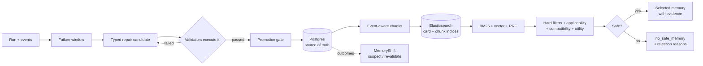

# RECAP

[](https://github.com/rezaxr14/Recap/actions/workflows/ci.yml)
[](https://www.python.org/downloads/)
[](LICENSE)
[](#project-status)

**R**etrieval-**E**nhanced **C**orrection and **A**daptive **P**ersistence for tool-using agents.

RECAP is a memory and recovery engine for agents that call tools. It records what an agent
did, compiles a typed repair from a failure, validates that repair by *executing* it in a
safe sandbox, promotes it to a retrievable memory only when the promotion policy passes, and
then serves those memories back with explicit compatibility and outcome-aware selection.

The central claim RECAP is built to test is not "RAG for agents". It is narrower and more
falsifiable: **retrieval relevance alone is not enough to decide whether a memory is safe to
apply.** A memory that is textually similar can be stale, schema-incompatible, or have a bad
verified track record. RECAP separates retrieval from selection so it can say *no safe
memory* instead of confidently returning the wrong one.

## Project status

**Alpha, single-node, deterministic by default.** The vertical slice is real: every
implemented local path is exercised against PostgreSQL 17 and Elasticsearch 8.19.3, and the
full suite runs in CI. It is not a hosted product. There is no multi-tenant auth layer, the
default embedder is a deterministic hashing embedder rather than a semantic model, and the
bundled evaluation split is deliberately small. The deterministic snapshot measures pipeline
and safety behaviour, while the separate live-model snapshot measures one configured model in
a deterministic mock environment. Neither is a general LLM-capability claim. See
[Known limits](#known-limits) for the honest gaps.

| At a glance | |
|---|---|
| **Core loop** | record -> compile a typed repair -> execute it in a sandbox -> promote only if valid -> retrieve with compatibility and outcome-aware selection |
| **Source of truth** | PostgreSQL 17 (runs, memories, chunks, outbox, snapshots, audit) |
| **Search** | Elasticsearch 8.19: BM25, dense vectors, hybrid RRF, card and chunk indices |
| **Interfaces** | `recap` CLI, FastAPI HTTP API, Python package |
| **Stack** | Python 3.12, FastAPI, SQLAlchemy 2, Alembic, Pydantic 2, Docker Compose |
| **Verification** | `269 passed, 1 skipped` locally; real-service integration tests; benchmark reproducibility gate |

---

## What actually works

Everything below is implemented and exercised against real PostgreSQL and a real
Elasticsearch 8.19.3 node. There are no stub endpoints in the implemented paths.

| Subsystem | Status | Evidence |
|---|---|---|
| Run recording with idempotent events + redaction | Working | `tests/unit/test_run_recorder.py`, `tests/integration/test_security.py` |
| PostgreSQL source of truth (Postgres 17, Alembic) | Working | `migrations/versions/`, `tests/integration/test_postgres.py` |
| Elasticsearch BM25 + dense vector + hybrid RRF | Working | `tests/integration/test_elasticsearch.py` |
| Lexical reranker + opt-in local CrossEncoder (`hybrid_rerank`) | Working; cross-encoder latency measured, quality comparison not yet meaningful | `tests/unit/test_reranker.py`, `tests/integration/test_cross_encoder_live.py`, `docs/evidence/phase1-rerank-benchmark/` |
| Outcome-aware selection with rejection reasons | Working | `tests/unit/test_recall_policy.py` |
| RepairCompiler (failure window -> typed candidate) | Working | `tests/unit/test_repair_compiler.py` |
| Static + executing mock-sandbox validators | Working | `tests/unit/test_repair_compiler.py` |
| Promotion gate (no bypass path) | Working | `tests/unit/test_repair_compiler.py`, `tests/integration/test_api.py` |
| MemoryShift drift detection + revalidation queue | Working | `tests/integration/test_postgres.py`, demo step 8 |
| Benchmark v2 (10 failure families, 120 tasks, family-held-out splits) | Implemented; dev split run with real nomic embeddings; test split not yet run | `tests/unit/test_benchmark_v2.py`, `tests/integration/test_benchmark_v2.py`, `docs/benchmark-v2.md`, `docs/evidence/phase2-summary.md` |
| Benchmark with card + chunk ablations and safety audit | Working (chunk ablation still degenerate on current data) | `recap eval run --suite v2`, `docs/results/2026-10-20-dev.md` |
| Transactional outbox + retry worker | Working | `tests/unit/test_outbox_worker.py`, `recap search drain` |
| Explicit memory versions + supersession | Working | `tests/unit/test_memory_versions.py`, `tests/e2e/test_lifecycle.py` |
| Run-level memory snapshot pinning | Working | `tests/integration/test_memory_snapshots.py` |
| Deterministic event-aware chunker (no downloads, fail-closed redaction) | Working | `tests/unit/test_chunking.py` |
| Chunk persistence, indexing, lifecycle, `reconcile --chunks` | Working | `tests/integration/test_chunks.py`, `migrations/versions/0004`-`0008` |
| Chunk-level retrieval (`*_chunk` modes) with supporting evidence | Working | `tests/integration/test_chunks.py`, `recap eval run` |
| Content-addressed Postgres embedding cache + usage reporting | Working | `tests/unit/test_embedding_cache.py`, `recap embedding-cache`, `recap eval run` |
| Versioned index rebuild + atomic alias swap (`search reindex`) | Working | `tests/integration/test_reindex.py`, `recap search reindex` |
| API-first chat/embedding providers (OpenAI-compatible) | Implemented; live-tested locally against LM Studio (`gemma-4-e4b-uncensored-hauhaucs-aggressive` + `nomic-embed-text-v1.5`), not in CI | `tests/unit/test_providers.py`, opt-in `tests/integration/test_live_providers.py`, `docs/evidence/phase1-live-provider-tests-gemma.txt` |
| LLM repair-candidate generation with typed validation | Implemented and unit-tested; **live acceptance failed** with gemma (0 schema-valid candidates) | `tests/unit/test_llm_generator.py`, `docs/evidence/phase1-summary.md` |
| Real LLM tool-using agent (`recap agent run`) | Implemented; live v1/v2 runs pass locally with gemma, not in CI | `tests/unit/test_llm_agent.py`, `tests/integration/test_llm_agent_recording.py`, `docs/evidence/live-runs/` |
| End-to-end demo (10 steps) | Working | `recap demo run` |

## Known limits

The project is deliberately explicit about what is not built. The capability table above,
the evidence under [`docs/evidence/`](docs/evidence/), and the limitations below are the
public record. A local implementation log is intentionally not published.

- The default embedding provider is a deterministic **hashing lexical embedder**, not a
  neural model. The benchmark v2 dev split was also run with real
  `text-embedding-nomic-embed-text-v1.5` (768-d) through LM Studio; those results are labelled
  separately and are still not LLM-agent results.
- The demo and benchmark use a **scripted reference agent** for reproducibility. The
  configured-LLM tool-using agent (`recap agent run`) completed live v1/v2 runs with
  `gemma-4-e4b-uncensored-hauhaucs-aggressive`, including the new `response_field` and
  `idempotency_key` families; the opt-in live suite passes locally
  (`docs/evidence/phase1-live-provider-tests-gemma.txt`), but still skips in CI. The benchmark
  numbers below were not produced by an LLM agent.
- Benchmark v2 is implemented but only the **dev** split has been measured. The held-out test
  families have not been run yet. `raw_trajectory_rag`, abstention precision/recall, and
  paired CIs across >= 3 seeds are not implemented; do not infer them from the report.
- **Live LLM repair generation is not working with the selected gemma model.** The acceptance
  harness produced 0 schema-valid candidates: `json_schema` calls timed out and `json_object`
  calls were rejected by the provider. The deterministic repair generator remains the default.
  See `docs/evidence/phase1-summary.md`.
- The **CrossEncoder reranker** is local-only and opt-in. Its real benchmark run records
  latency and provenance, but the two-task dev split cannot show a quality improvement over
  lexical or bi-encoder retrieval.
- The Postgres **embedding cache** is implemented and keyed by the exact fingerprint; it
  caches vectors, not query results, so a hit does not bypass retrieval or policy checks.
  Cache hits, misses, provider batches, latency, and provider-reported prompt tokens appear in
  the benchmark JSON/Markdown; missing provider usage is reported as `null`. The cache has no
  automatic eviction yet; `last_accessed_at`/`hit_count` support manual pruning, and
  `recap embedding-cache --clear` is always safe.
- The chunk token counter is a download-free approximation, not a model tokenizer.
- The current dev split has no same-environment distractor set, so the `naive_fixed` vs
  `event_aware` chunk ablation is **degenerate**. It needs same-environment noise and
  near-duplicate memories before it can support a claim.
- The stack is single-node and local-first. Elasticsearch security is disabled in the local
  Compose file, and there is no multi-tenant auth or RBAC layer.
- Benchmark numbers measure **pipeline and safety behaviour**, not LLM capability. Reports
  and `recap providers` state which mode produced a result.

## Results snapshot (benchmark v2 dev, real nomic embeddings)

These are measured numbers from `recap eval run --suite v2 --split dev`, not projections.
They use 24 tasks, the scripted reference agent, and real
`text-embedding-nomic-embed-text-v1.5` 768-d embeddings through LM Studio.

| Baseline | recall@3 | MRR | task success | harmful transfer | incompatible selection |
|---|---:|---:|---:|---:|---:|
| `no_memory` / `retry_only` | 0.000 | 0.000 | 0.000 | 0.000 | 0.000 |
| `bm25` / `vector` / `hybrid_rrf` | 1.000 | 0.750 | 0.500 | 0.500 | 1.000 |
| `hybrid_rrf_version_filter` | 1.000 | 1.000 | 1.000 | 0.000 | 0.000 |
| `outcome_aware` | 1.000 | 0.750 | 1.000 | **0.000** | **0.000** |
| `*_naive_chunk` / `*_chunk` | 1.000 | 1.000 | 1.000 | 0.000 | 0.000 |

On this split the fair version filter also fixes stale-version selection, so the full policy
does **not** show a success advantage over it. The policy matches its success while rejecting
wrong-family and bad-track-record distractors; its MRR is lower (0.750 vs 1.000). The chunk
comparison is **degenerate** because there is no same-environment distractor set. Full matrix,
CIs, and caveats: [`docs/evidence/phase2-summary.md`](docs/evidence/phase2-summary.md) and
[`docs/benchmark-v2.md`](docs/benchmark-v2.md).

### Real-model check (Phase 3, in progress)

A separate run uses the live LM Studio model `gemma-4-e4b-uncensored-hauhaucs-aggressive`
(temperature 0, prompt `llm-tool-agent-v1`, six-tool budget) on the same 24 dev tasks:

| Baseline | recall@3 | MRR | task success | harmful transfer | incompatible selection | input tokens |
|---|---:|---:|---:|---:|---:|---:|
| `no_memory` | 0.000 | 0.000 | 1.000 | 0.000 | 0.000 | 21,282 |
| `bm25` | 1.000 | 0.750 | 1.000 | 0.000 | 1.000 | 54,556 |
| `hybrid_rrf_version_filter` | 1.000 | 1.000 | 1.000 | 0.000 | 0.000 | 50,863 |
| `outcome_aware` | 1.000 | 0.750 | 1.000 | 0.000 | 0.000 | 50,073 |

The live model solved every dev task with no memory. That is a **ceiling effect**, not evidence
that memory is useless: `bm25` selected an incompatible memory on 24/24 tasks and still
succeeded, because the model verified against the live schema. The retrieval metrics expose the
bad ranking; task success does not. This run is one model, one seed, and four of sixteen
baselines. Details and limits:
[`docs/evidence/phase3-llm-dev-core/summary.md`](docs/evidence/phase3-llm-dev-core/summary.md)
and [`docs/results-llm.md`](docs/results-llm.md).

## Documentation

| If you want to... | Read |
|---|---|
| Understand the system | [`docs/architecture.md`](docs/architecture.md), [`docs/data-model.md`](docs/data-model.md), [`docs/retrieval.md`](docs/retrieval.md) |
| Run and operate it | [`docs/operations.md`](docs/operations.md), [Quickstart](#quickstart) |
| Understand repair and safety | [`docs/repair-validation.md`](docs/repair-validation.md), [`docs/threat-model.md`](docs/threat-model.md) |
| Evaluate it | [`docs/evaluation-methodology.md`](docs/evaluation-methodology.md), [`docs/benchmark-v2.md`](docs/benchmark-v2.md), [`docs/results.md`](docs/results.md), [`docs/evidence/phase2-summary.md`](docs/evidence/phase2-summary.md) |
| Connect a model | [`docs/providers.md`](docs/providers.md) |
| Contribute | [`CONTRIBUTING.md`](CONTRIBUTING.md), [`SECURITY.md`](SECURITY.md), [`CHANGELOG.md`](CHANGELOG.md) |
| Repository metadata | [`docs/github-repository.md`](docs/github-repository.md) |

The full index is [`docs/README.md`](docs/README.md).

---

## Quickstart

### 1. Services

```bash
docker compose up -d postgres elasticsearch
```

- PostgreSQL 17 on `localhost:5433` (`recap` / `recap` / `recap`)
- Elasticsearch 8.19.3 on `localhost:9200`, security disabled for local use only

If another RECAP checkout is already running on this machine, stop that stack first
(`docker compose down` in the other checkout). The Compose file uses fixed container names
and host ports, so two checkouts cannot run simultaneously without overriding them.

The local services use `restart: "no"` and are not started by Docker/Windows at login. Start
them explicitly for integration tests, then stop them to release RAM:

```bash
docker compose up -d postgres elasticsearch
docker compose stop postgres elasticsearch
```

### 2. Install

```bash
python -m venv .venv
.venv/Scripts/activate        # Windows
# source .venv/bin/activate   # Unix
pip install -e ".[dev]"
```

Python 3.12+ is required.

### 3. Initialize and verify

```bash
recap db migrate
recap search init
recap health
python scripts/run_smoke_test.py
```

`run_smoke_test.py` is operator-facing: it prints each check as `PASS`/`FAIL` and exits
non-zero on any deviation.

### 4. Configure real models (API-first)

RECAP never downloads model weights. Point it at an already-running OpenAI-compatible
endpoint:

PowerShell:

```powershell
$env:EMBEDDING_PROVIDER = "openai_compatible"
$env:EMBEDDING_BASE_URL = "https://api.example.com/v1"
$env:EMBEDDING_API_KEY = "..."
$env:EMBEDDING_MODEL = "text-embedding-3-small"
$env:EMBEDDING_DIMENSIONS = "1536"

$env:LLM_PROVIDER = "openai_compatible"
$env:LLM_BASE_URL = "https://api.example.com/v1"
$env:LLM_API_KEY = "..."
$env:LLM_MODEL = "gpt-4.1-mini"

recap providers          # offline capability report, no secrets
recap doctor --live      # probes configured endpoints, one small chat + embedding
recap agent run --environment-version 2 --workspace live-agent
```

Bash / zsh:

```bash
export EMBEDDING_PROVIDER=openai_compatible
export EMBEDDING_BASE_URL=https://api.example.com/v1
export EMBEDDING_API_KEY=...
export EMBEDDING_MODEL=text-embedding-3-small
export EMBEDDING_DIMENSIONS=1536

export LLM_PROVIDER=openai_compatible
export LLM_BASE_URL=https://api.example.com/v1
export LLM_API_KEY=...
export LLM_MODEL=gpt-4.1-mini

recap providers
recap doctor --live
recap agent run --environment-version 2 --workspace live-agent
```

`recap agent run` drives the configured chat model through a bounded tool-calling loop
against the mock API. The model selects `list_records` arguments; RECAP validates the tool
name and arguments, executes only that local tool, and computes success from the records
actually collected. It refuses to run when no `llm` role is configured and never falls back
to the deterministic agent. The recorded run includes provider, model, prompt version, token
usage, and every tool call/failure. Add `--transcript path.json` to write a redacted
run/event transcript.

### 5. Elasticsearch index generations and reranking

Changing an embedding model or vector dimension requires a new index generation. Do not
edit the old mapping in place:

```bash
recap search reindex --to-generation v2
# inspect v2, then optionally remove the old concrete index
recap search reindex --to-generation v3 --delete-old
```

The reindex command re-embeds active memories from Postgres into a fresh concrete index,
verifies its document count, swaps the read and write aliases in one atomic request, and
updates the Postgres generation provenance. The old index stays behind the read alias until
the swap, is retained by default for rollback, and is deleted only with `--delete-old` after
the swap and database update succeed. See
[`docs/operations.md`](docs/operations.md#rebuild-a-memory-index-generation-without-downtime).

The optional local CrossEncoder reranker is also opt-in and never downloads weights:

```bash
pip install -e ".[rerank]"
$env:RERANK_PROVIDER = "cross_encoder"
$env:RERANK_MODEL_PATH = "models/ms-marco-MiniLM-L-6-v2"
recap memory search "cursor expired" --mode hybrid_rerank
```

`recall.reranker=lexical` remains the default. The cross-encoder path requires an existing
local model directory and `local_files_only=True`; every decision records the reranker name,
model path, and per-stage rerank latency.

`hashing`/`fake` embeddings remain available for offline development and unit tests, but they
are reported as non-semantic. Production rejects them unless `EMBEDDING_ALLOW_DEGRADED=true`
is explicitly set. The embedding dimension must match the Elasticsearch mapping; changing
models requires a new index generation. Details: [`docs/providers.md`](docs/providers.md).

### 5. Run the demo

```bash
recap demo run
```

This executes the whole story end to end and writes `demo_report.md`:

1. Record a failed run against mock API v1 (expired cursor).
2. Compile a repair candidate from the failure window.
3. Validate it in the mock sandbox (actually reproduces the failure, applies the strategy).
4. Promote it through the policy gate.
5. Retrieve it for a new run and apply it; the run succeeds.
6. Upgrade the environment to v2 (parameter renamed `cursor` -> `page_token`).
7. Try to reuse the v1 memory: it is rejected as incompatible. The run **fails closed**
   rather than applying a stale repair.
8. Compile, validate, and promote a v2 memory.
9. The v2 memory is retrieved and the run succeeds.
10. Run the benchmark and emit JSON/CSV/Markdown reports.

### 6. Benchmark

```bash
recap eval run --split dev
recap eval run --split test
```

Reports land in `benchmark/reports/`. See
[`docs/evaluation-methodology.md`](docs/evaluation-methodology.md) for what the numbers do
and do not mean.

Reproducibility check (the same gate CI runs):

```bash
python scripts/run_benchmark_repro.py
```

### 7. HTTP API

```bash
recap serve --port 8000
```

`GET /health/live`, `GET /health/ready`, `GET /api/v1/diagnostics`. Full route list in
[`docs/operations.md`](docs/operations.md).

---

## CLI surface

```
recap version
recap health
recap providers
recap doctor [--live]
recap serve

recap db migrate | init
recap search init | health | reconcile [--chunks] | drain | outbox
recap memory search | show | compatibility
recap chunk build | show | count
recap repair compile | validate | promote
recap agent run --environment-version 1
recap demo seed | run
recap eval run
```

Every command performs real work. Nothing prints success for an operation that did not run.

---

## Architecture in one paragraph

PostgreSQL is the source of truth. Elasticsearch is a rebuildable index behind
`recap-memories-read` / `recap-memories-write` aliases with a versioned index name; a second
chunk index (`recap-chunks-*`) stores deterministic chunks derived from the same memories and
their evidence runs, so retrieval can be ablated at card or chunk granularity. Model
access is isolated behind `ChatProvider`/`EmbeddingProvider` ports with independent agent,
repair, and embedding roles; the remote adapters speak the OpenAI-compatible API and never
download weights. A run is recorded as an ordered event stream; a failure window is extracted
from that stream; the RepairCompiler turns it into a typed, allowlisted strategy; validators
execute it in a disposable mock environment; the PromotionService is the only path to
`active`; and the RecallEngine fuses lexical and vector branches, applies hard filters,
evaluates preconditions and compatibility, scores utility with logged features, and persists
the full decision including *why each candidate was rejected*. MemoryShift watches outcomes
and environment fingerprints, downgrades memories to `suspect`, and queues revalidation
instead of silently rewriting history.



Deeper reading:

- [`docs/architecture.md`](docs/architecture.md) — components, boundaries, request flow
- [`docs/data-model.md`](docs/data-model.md) — tables, lifecycle, invariants
- [`docs/retrieval.md`](docs/retrieval.md) — branches, fusion, policy, ablation design
- [`docs/repair-validation.md`](docs/repair-validation.md) — failure windows, validators, promotion
- [`docs/drift-detection.md`](docs/drift-detection.md) — compatibility, degradation, revalidation
- [`docs/evaluation-methodology.md`](docs/evaluation-methodology.md) — baselines, metrics, leakage
- [`docs/providers.md`](docs/providers.md) — model roles, API endpoints, degraded mode, live tests
- [`docs/threat-model.md`](docs/threat-model.md) — assets, attackers, controls, non-goals
- [`docs/operations.md`](docs/operations.md) — runbook, health, recovery, failure modes

ADRs:

- [`0001-source-of-truth.md`](docs/adr/0001-source-of-truth.md)
- [`0002-elasticsearch-hybrid-retrieval.md`](docs/adr/0002-elasticsearch-hybrid-retrieval.md)
- [`0003-memory-promotion-policy.md`](docs/adr/0003-memory-promotion-policy.md)

---

## Safety posture

- **Retrieved memory is untrusted data.** It is rendered as structured fields; RECAP never
  executes code from a memory. Actions are typed enum templates interpreted by the caller.
- **Fail closed.** Unknown preconditions, incompatible or suspect compatibility, missing
  validation, and low utility all produce `no_safe_memory` rather than a best guess.
- **No promotion bypass.** `PromotionService` is the only writer of `active` memories from a
  candidate, and it re-checks evidence, validation, duplicates, and secret leakage.
- **Redaction at the boundary.** Payloads are redacted before persistence, and memory free
  text is re-redacted before indexing.
- **No secrets in git.** `.env` is ignored; `.env.example` contains only local defaults.

See [`docs/threat-model.md`](docs/threat-model.md) for the full analysis, including what
RECAP explicitly does *not* defend against.

---

## Development

```bash
ruff check src tests scripts
ruff format --check src tests scripts
mypy src

pytest tests/unit              # unit tests only, no services
pytest --run-integration       # + live Postgres/Elasticsearch
```

Integration tests are opt-in and use an isolated database (`recap_test`) and index prefix
(`recap-test-*`), so they cannot touch development data.

Live model-endpoint tests are additionally gated:

```bash
export RECAP_RUN_PROVIDER_INTEGRATION=1
pytest tests/integration/test_live_providers.py --run-integration
```

They skip when no real endpoint is configured. They are the only acceptable evidence for
real-model integration; mocked transport tests and the deterministic demo are not.

Windows note: `make` is often unavailable. `scripts/dev_targets.py` mirrors the Makefile
targets; `Makefile` works on Unix and in CI.

### Repository layout

```
src/recap/
  domain/            pure models, enums, predicates, lifecycle rules
  recorder/          event ingestion, normalization, redaction
  recall/            query building, eligibility, applicability, utility policy, engine
  repair_compiler/   failure windows, generation, validation, promotion
  memory_shift/      compatibility, degradation, revalidation
  providers/         ChatProvider/EmbeddingProvider ports + OpenAI-compatible adapters
  infrastructure/    SQLAlchemy, Elasticsearch, embeddings
  environments/      mock API, deterministic reference agent, configured-LLM agent
  evals/             datasets, metrics, benchmark runner
  api/               FastAPI routes
  demo.py            the 10-step end-to-end flow
migrations/          Alembic
configs/             default.yaml
docs/                design + operations documentation
```

---

## Contributing

Contributions are welcome. Read [`CONTRIBUTING.md`](CONTRIBUTING.md) for the local setup,
test matrix, migration rules, and pull-request checklist. Participation follows the
[`CODE_OF_CONDUCT.md`](CODE_OF_CONDUCT.md). Report vulnerabilities privately using the
process in [`SECURITY.md`](SECURITY.md), not a public issue. Release notes are in
[`CHANGELOG.md`](CHANGELOG.md).

## License

Apache-2.0. See [`LICENSE`](LICENSE).
