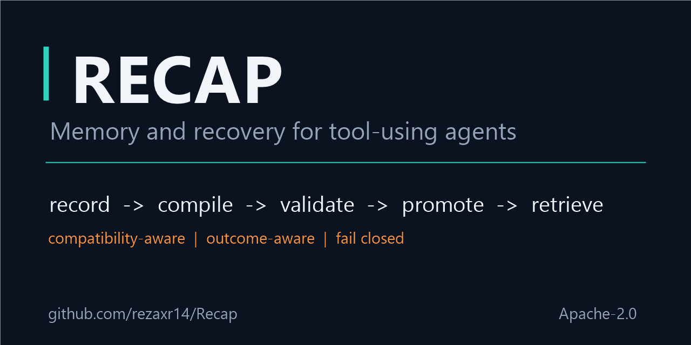

# GitHub repository metadata

This page records the public metadata for the repository and the exact values used, so the
About panel, package metadata, and README describe the same project.

**Last applied:** 2026-10-20 via the GitHub REST API. The repository is public, the default
branch is `master`, and the About description and 18 topics below are live.

## About

**Description**

> RECAP: a memory and recovery engine for tool-using agents. Record runs, compile and validate
> repairs, promote verified memories, and retrieve them with compatibility and outcome-aware
> selection.

**Topics**

`ai-agents`, `agent-memory`, `tool-use`, `retrieval`, `rag`, `hybrid-search`, `bm25`,
`vector-search`, `postgresql`, `elasticsearch`, `fastapi`, `python`, `llm`, `repair`,
`benchmark`, `deterministic-testing`, `sandbox-validation`, `outcome-aware`

**Homepage**

Leave blank until a hosted documentation site exists. [The README](../README.md) and the
[documentation index](README.md) are the canonical entry points.

**Visibility:** public. **Default branch:** `master`. **Issues:** enabled.
**Security advisories:** GitHub private vulnerability reporting is enabled. `SECURITY.md`
points to the private advisory form and gives a fallback if it is ever unavailable.

## Applying the metadata

The values can be set in **Settings -> General** in the GitHub web UI, or with the `gh` CLI:

```bash
gh repo edit rezaxr14/Recap \
  --description "RECAP: a memory and recovery engine for tool-using agents. Record runs, compile and validate repairs, promote verified memories, and retrieve them with compatibility and outcome-aware selection." \
  --add-topic ai-agents \
  --add-topic agent-memory \
  --add-topic tool-use \
  --add-topic retrieval \
  --add-topic rag \
  --add-topic hybrid-search \
  --add-topic bm25 \
  --add-topic vector-search \
  --add-topic postgresql \
  --add-topic elasticsearch \
  --add-topic fastapi \
  --add-topic python \
  --add-topic llm \
  --add-topic repair \
  --add-topic benchmark \
  --add-topic deterministic-testing \
  --add-topic sandbox-validation \
  --add-topic outcome-aware
```

The same values can be set through the REST API:

```text
PATCH /repos/rezaxr14/Recap
{"description": "..."}

PUT /repos/rezaxr14/Recap/topics
{"names": ["ai-agents", "agent-memory", "..."]}
```

## Social preview

GitHub's social preview image is uploaded in **Settings -> General -> Social preview**. A
1280x640 candidate is checked in at [`assets/social-preview.png`](assets/social-preview.png):



It uses the project name, the one-line description, and the
record -> compile -> validate -> promote -> retrieve loop. Keep text large enough to read in
a timeline card, and do not put secrets or benchmark numbers that can go stale in the image.
The social-preview field itself is a repository setting, so it still needs the web UI or a
manual upload; there is no stable REST endpoint for it.
